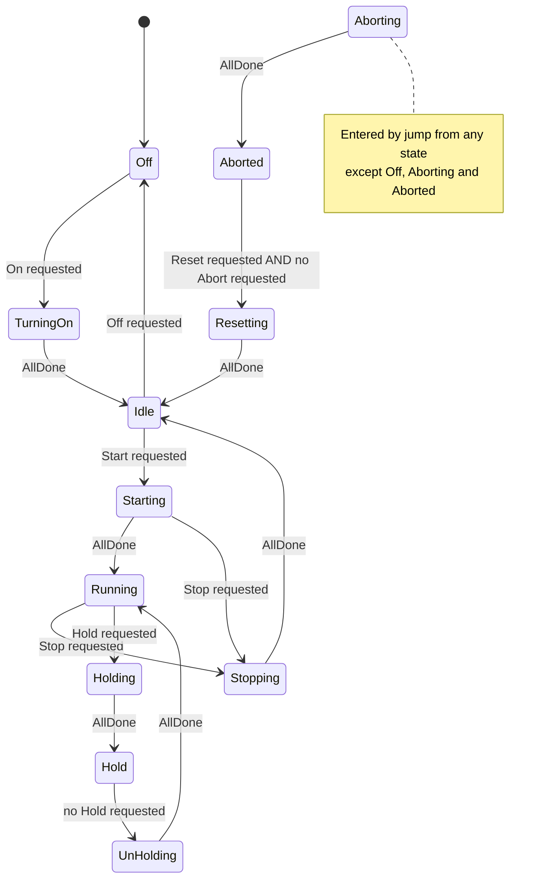
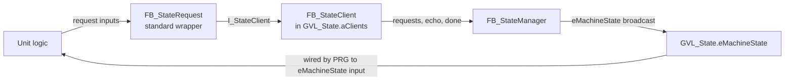
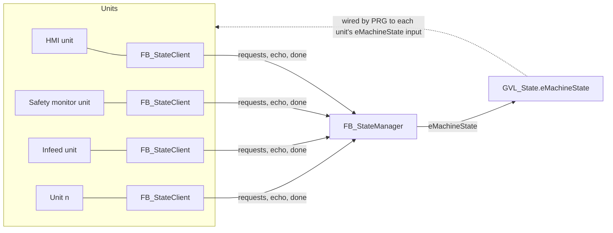

# Central Machine State Management: Design

*2026-10-08 · Draft for review*

## 1. Purpose and scope

One central **state manager**, `FB_StateManager`, owns the operating state of the whole machine. Each unit (axis group, conveyor, heater, station, HMI…) has an **`FB_StateClient`** attached and talks to the manager only through it, using the standard **`FB_StateRequest`** wrapper (§5):

- **The state is broadcast.** The manager publishes one value, `GVL_State.eMachineState`. Each unit receives it as an **`eMachineState` input**, which the calling program wires to the broadcast. Units never read the GVL themselves (see open question 7).
- **The client carries only requests upward.** The unit uses it to echo the state it's acting on, report done, and make requests (abort, hold, …).

The manager reads all clients each scan, decides the state and publishes it. Units never talk to the manager or to each other directly.

**The state manager owns:**
- the machine state and every transition between states;
- the rules for which requests act in which states;
- timeouts on the transitional states;
- recording the first abort cause and which client raised it.

**It does not own:**
- *how* a unit turns on, starts, stops, holds or aborts. That logic lives in the unit.
- Safety functions. E-stop, guard and STO circuits are handled by the safety system. The safety status reaches the manager only as an abort request, from a client owned by the safety-monitoring unit.

## 2. States

| State | Kind | Meaning | What the units do |
|---|---|---|---|
| **Off** | Stable (default) | The machine is de-energised. This is the power-up state. | Everything is off and safe. |
| **TurningOn** | Transitional | The machine is bringing systems up. | Power drives, enable heaters, establish comms… |
| **Idle** | Stable | Everything is on and ready, but no production. There's no fault in Idle. | Hold ready. No motion. |
| **Starting** | Transitional | Preparing for production. | Home or move to start positions, ramp up, prime… |
| **Running** | Stable | Producing. | Normal cyclic operation. |
| **Stopping** | Transitional | Controlled stop at the end of a cycle. | Finish the current cycle and bring to rest. |
| **Holding** | Transitional | Pausing production in a resumable way. | Pause at a safe point and keep position and context. |
| **Hold** | Stable | Paused, and production can resume. | Stay paused. |
| **UnHolding** | Transitional | Resuming from Hold. | Restore motion and context. |
| **Aborting** | Transitional | Fast stop because something is wrong. | Stop as quickly as is safe, in the shortest way. |
| **Aborted** | Stable | Stopped after an abort and waiting for reset. | Stay stopped and safe. |
| **Resetting** | Transitional | Recovering from an abort. | Clear faults, re-enable, return to a known condition. |

Every **transitional** state has a timeout (see §4) and leaves when **all clients are done** with it. **Stable** states have no timeout, and they leave on requests.

## 3. Transitions

`AllDone` means every active client reports that it has finished the current state (see §6).

### State diagram



### Transition table (normal transitions)

The requests are the combined (OR) requests from all clients, as levels.

| From | Condition | To |
|---|---|---|
| Off | `On AND NOT Off` | TurningOn |
| TurningOn | `AllDone` | Idle |
| Idle | `Off` | Off |
| Idle | `Start AND NOT Stop AND NOT Off` | Starting |
| Starting | `Stop` | Stopping |
| Starting | `AllDone` | Running |
| Running | `Stop` | Stopping |
| Running | `Hold` | Holding |
| Stopping | `AllDone` | Idle |
| Holding | `AllDone` | Hold |
| Hold | `NOT Hold` | UnHolding |
| UnHolding | `AllDone` | Running |
| Aborting | `AllDone` | Aborted |
| Aborted | `Reset AND NOT Abort` | Resetting |
| Resetting | `AllDone` | Idle |

Notes:
- **Priorities inside Running:** stop is checked before hold, so if both are requested the machine stops.
- **Stop during Starting** always goes to Stopping, whether or not starting has completed. Stop is checked before AllDone.
- **Hold lasts while any client requests it.** The machine resumes only when **no** client requests hold any more, so a starved infeed and an operator pause can overlap safely.
- **Off is reached only from Idle.** Going from Running to Off therefore passes through Stopping first.
- **`Aborted → Resetting` requires that no client still requests an abort.** A held abort can't be reset away.

## 4. Jumps: abort and timeouts

The jumps are evaluated **before** the transitions, in priority order, from every state except Off, Aborting and Aborted:

| Priority | Condition | To | Recorded |
|---|---|---|---|
| 1 | Any client requests an abort | Aborting | That client's abort code, the client's index, and the state it came from |
| 2 | Step timer of the current transitional state has expired | Aborting | "Timeout", the state, the first client that wasn't done, and whether it never acknowledged or never finished (see §6) |

The transition CASE then runs as normal on the state the jump set. Exits from Aborting are themselves conditions (`AllDone`), so a transition that fires in the same scan is a correct one.

**Fault information:**
- Only the **first** cause is recorded. The jumps aren't evaluated in Aborting or Aborted, so later faults can't overwrite it.
- **Units don't raise fault-based abort requests in Aborting, Aborted or Resetting.** A fault is reset *in* Resetting, but Aborted → Resetting requires that no client requests an abort, so a fault that's still present would block its own reset. A fault that survives the reset leaves the unit not done, and the Resetting timeout aborts again. Deliberate aborts (operator, safety) keep requesting, so they still block the reset.
- The cause is **cleared on entry to Idle**. Idle means nothing is wrong, so there's no fault to show. The cause stays visible for the whole Aborting → Aborted → Resetting path.

**Timeout in Aborting.** If clients don't confirm Aborting within the abort timeout, the machine still goes to Aborted. The client that didn't confirm is recorded as a second diagnostic. Reaching a resettable state matters more than waiting forever.

## 5. Clients: interface, client FB and wrapper

A client has three standard layers. They're the same for every unit:



1. **`I_StateClient` (interface).** The standard way to talk to a client: request levels, state echo and done, all going up to the manager.
2. **`FB_StateClient IMPLEMENTS I_StateClient`.** The actual client. It stores the request levels, echo and done. The manager reads these instances (§6). The client doesn't carry the state; that's the broadcast.
3. **`FB_StateRequest` (wrapper).** The one block a unit uses. It holds the attached `I_StateClient`, checks it isn't null, and forwards the unit's inputs through the interface every call. Units never touch the interface or the client directly, so using a client takes a single FB call.

### `I_StateClient`

| Member | Kind | Meaning |
|---|---|---|
| `Request(bOn, bOff, bStart, bStop, bHold, bAbort, uiAbortCode, bReset)` | Method | Sets this client's request levels. Every call overwrites all of them. |
| `Report(eStateEcho, bDone, bEnable)` | Method | The state the unit is acting on, whether it's finished, and whether the client takes part at all. |

### `FB_StateRequest` (wrapper)

| Inputs | Outputs |
|---|---|
| `itfClient : I_StateClient`: the attached client | `bAttached`: `itfClient <> 0` |
| `bOn`, `bOff`, `bStart`, `bStop`, `bHold`, `bReset`: requests (levels, default FALSE) | |
| `bAbort`, `uiAbortCode`: abort request and its reason | |
| `eStateEcho`, `bDone`: progress on the current state | |
| `bEnable` (default TRUE): FALSE switches the unit out of the machine state | |

A unit connects only the inputs it uses, and the rest stay FALSE. Usage, called with the unit's other sub-FBs at the end, before the unit's outputs:

```iecst
_fbStateReq(
    itfClient   := itfClient,                  // the unit's I_StateClient input; the caller wires GVL_State.aClients[CLIENT_INFEED]
    bAbort      := _eState = E_InfeedState.Faulted,
    uiAbortCode := _uiFaultCode,
    bHold       := _eState = E_InfeedState.Starved,
    eStateEcho  := _eMachineStateSeen,      // machine state this unit's state machine has taken over
    bDone       := _bStepDone);
```

Inside, the wrapper does `IF itfClient <> 0 THEN itfClient.Request(...); itfClient.Report(...); END_IF`. All requests are written every call, so releasing an input releases the request.

The unit's own state machine follows the machine state it's given: its transitions read its `eMachineState` input (latched once per scan into an internal variable), and when it has taken a machine state over it echoes that state back through the wrapper. The calling program wires the input, normally `eMachineState := GVL_State.eMachineState`.

**Done is the echoed state plus a done bit.** The manager counts a client as done only when `eStateEcho = current state AND bDone`:
- **Echo without done:** the unit has picked up the new state and is working on it. The manager can show which units are still busy, and a timeout can name the one that never acknowledged.
- **Echo of an old state:** the unit hasn't taken the new state over yet. Its `bDone` refers to the old state and is ignored. A stale done from Holding can never satisfy UnHolding.
- The unit sets both from its own state machine: `eStateEcho` follows the state it's actually in, and `bDone` comes from its own logic. Both are levels, and there's nothing to clear.

**Units with nothing to do** in a state echo it and set `bDone` straight away. For example, a heater has nothing to hold, so in Holding it reports done immediately.

**Commands are levels.** The HMI is just another client, so operator buttons are held requests too. There are no rising edges anywhere: stable states wait for a request to change, so a held request can't re-trigger anything. That works the same way as `Done`, which waits for `Execute` to drop.

## 6. The manager: how clients are combined



Each scan, `FB_StateManager` runs the house sequence structure, with one extra section in front:

0. **Read clients.** A `FOR` loop over the client array builds the combined requests and `AllDone`:
   - each request (`Abort`, `Hold`, `Stop`, `Start`, `On`, `Off`, `Reset`) is the OR across all active clients;
   - `AllDone` is the AND of `client.eStateEcho = _eState AND client.bDone` across all active clients;
   - the loop records the **first** client requesting an abort (index and code), and the **first** client that isn't done. It also notes whether that client hasn't acknowledged (echo ≠ state) or is still working (echo = state, not done), for timeout diagnostics.
1. **Jumps:** abort, then timeout (§4).
2. **Transitions:** a `CASE` with only the state changes in §3, plus `ELSE` → Aborting.
3. **On change:** `IF _eState <> _eLastState`. First the common actions: restart the step timer and clear the timeout. Then the per-state entry actions: set the timeout for each transitional state, and clear the abort info on entering Idle.
4. **Cyclic:** the manager's outputs, including the broadcast `eMachineState`, are copied from internal variables, and the step timer is called last.

The clients are read at the start and the state is published at the end, so units always see the state the manager settled on in this scan. A unit that reports done is picked up in the manager's next scan. Data flows one way through each path: requests go up through the clients, and the state comes down through the broadcast.

## 7. Implementation notes

**Registering clients.** There are two options (see §8):
- **A. Array passed in:** `VAR_IN_OUT aClients : ARRAY[*] OF FB_StateClient`, with the array declared in a GVL (`GVL_State.aClients[1..MAX_CLIENTS]`). Each unit is given a fixed index (constant), so `GVL_State.aClients[CLIENT_INFEED]`. Bounds come from `LOWER_BOUND`/`UPPER_BOUND`. This is simple and visible online, and adding a unit means adding one constant.
- **B. Registration by reference:** each unit's client calls `fbManager.Register(THIS^)` once, and the manager stores `REFERENCE TO FB_StateClient` in a fixed-size table. Clients live inside their units, but it adds init-order and online-change concerns.

**Active clients.** A client counts toward `AllDone` and the request ORs only while it's enabled. **A client starts disabled**, and it becomes enabled when a unit's `FB_StateRequest` reports `bEnable` (default TRUE). Unused slots in `aClients` are therefore ignored, so they can't block `AllDone`. A unit that's switched out (e.g. an optional station) passes `bEnable := FALSE` instead of reporting done everywhere.

**Types and conventions:**
- **`E_MachineState`** is an enum with `{attribute 'qualified_only'}` and `{attribute 'strict'}`, numbered implicitly from `Off := 0`. It's an enum because the state is exposed.
- **Internal state:** `_eState`, `_eLastState`, `_uiAbortCode`, `_iAbortClient` and `_eAbortFrom` are the manager's internal variables. The outputs are copies.
- **Timeouts and client indexes** are `VAR CONSTANT`s.
- **No first-scan logic.** The machine starts in Off, which does nothing, and every client's defaults (`eStateEcho` = Off, `bDone` = FALSE) are consistent with that.

**Manager outputs**, published to `GVL_State`: `eMachineState` (the broadcast), plus `uiAbortCode`, `iAbortClient`, `eAbortFrom` and `iNotDoneClient` for the HMI and diagnostics. A unit that wants to know whether it caused the abort compares `iAbortClient` with its own client index.

## 8. Assumptions and open questions

**Assumed (please confirm):**
1. "someStartCmd → Start → Starting" has been read as a single `Starting` state. There's no separate `Start` state.
2. Reset leads to **Idle**: Aborted → Resetting → Idle.
3. Abort applies from every state except Off, Aborting and Aborted.
4. A transitional-state timeout counts as an abort, not as a separate Faulted state.

**Open questions:**
1. ~~**Client registration**~~ **Decided:** option A. `GVL_State.aClients[1..MAX_CLIENTS] OF FB_StateClient` is passed to the manager as `VAR_IN_OUT ARRAY[*]`, and each unit uses a `CLIENT_*` index constant.
2. ~~**Request policy**~~ **Decided:** all requests are equal. Every enabled client's requests are combined (OR) the same way, whichever client they come from.
3. ~~**Stop while in Hold or Holding**~~ **Decided:** not needed. Stop acts from Running only, so a held machine resumes first. (The servo sequence would handle a stop from any step anyway.)
4. ~~**Stop while Starting**~~ **Decided:** a stop request in Starting always goes to Stopping, whether or not starting has completed. Units must handle a stop from mid-start; the servo sequence does this with its stop jump.
5. ~~**Off:** a `TurningOff` state?~~ **Decided:** no. Going to Off just powers the axes down. The drive supply already waits until no axis is under torque before it switches off, so the order is right without an extra state.
6. ~~**Start held through a stop**~~ **Decided:** the machine just starts again. A start request still held when Stopping returns to Idle restarts it, as written.
7. ~~**How units get the broadcast state**~~ **Decided:** as an input. No FB reads or writes a global variable (global constants are fine). Every unit has an `eMachineState : E_MachineState` input, and only the calling program wires it to `GVL_State.eMachineState`. Reason: if the machine grows and needs another layer of state management (e.g. a sub-manager per section of the line), a unit can be given that sub-manager's state instead of the machine state, without any change inside the unit. It also makes every unit's dependencies visible at its call site.
