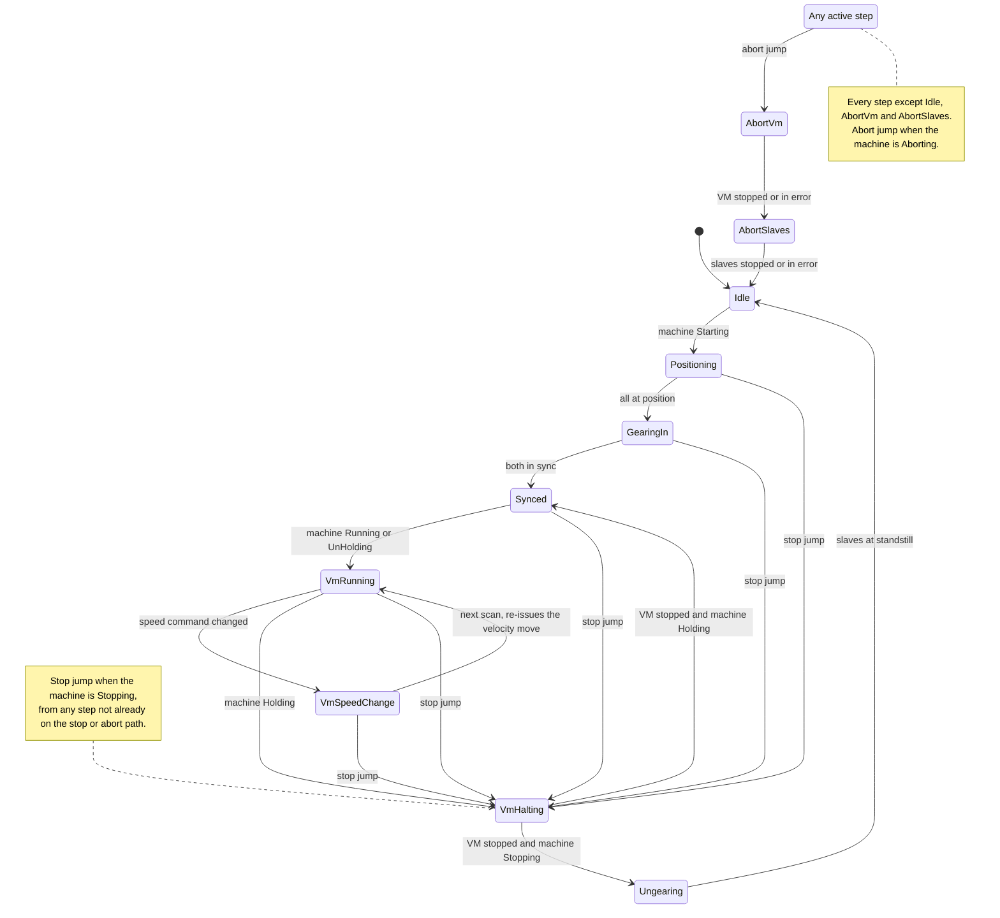

# Unit: Servo Station: Design

*2026-10-08 · Draft for review · Parent: [Central State Management](Central_State_Management_Design.md)*

## 1. Purpose and scope

The servo station has **two real servo axes** and **one virtual master (VM)**. In production, both real axes are geared 1:1 to the VM at caller-supplied phase offsets, and the line speed is the VM's velocity.

The unit follows the machine state it's given as its `eMachineState` input (wired by the calling program to the broadcast `GVL_State.eMachineState`; central doc, open question 7) and is split into two blocks. Each block has its own state client (`FB_StateRequest`):

| Block | Job |
|---|---|
| **`FB_ServoAxisMgr`** | Axis power on/off, fault detection with abort requests, and axis fault reset. |
| **`FB_ServoMotionSeq`** | All motion: positioning, gear-in, VM speed, hold/unhold, stop and abort sequences. |

The manager waits for **both** clients before it leaves a transitional state. Power and motion therefore stay independent, and neither block needs to know the other's internals.

This document says *what* each block commands. It doesn't commit to a motion library. Commands are named by function (power, reset, absolute move, gear-in, velocity move, halt, stop), and the implementation picks the library that provides them.

## 2. Axes

| Name | Type | Role |
|---|---|---|
| `Ax1` | Real servo, rotary modulo 360° | Slave 1, geared 1:1 to the VM at `lrAx1Offset` |
| `Ax2` | Real servo, rotary modulo 360° | Slave 2, geared 1:1 to the VM at `lrAx2Offset` |
| `VM` | Virtual axis, rotary modulo 360° | Master. Its velocity is the line speed. |

The offsets are **inputs from the caller** (§5). For the current machine the caller passes `OFFSET` for Ax1 and `360 − OFFSET` for Ax2. The blocks don't know or assume that relationship.

## 3. `FB_ServoAxisMgr`: power, faults, reset

### Behaviour per machine state

| Machine state | Axis power | Done when |
|---|---|---|
| **Off** | Off | All 3 axes report disabled |
| **TurningOn** | On, once the axis reports ready for power (see below) | All 3 powered, no axis error |
| Idle, Starting, Running, Stopping, Holding, Hold, UnHolding | On | Immediately: nothing to do beyond staying powered |
| **Aborting** | On while the motion block stops the axes. Once **all axes are at rest** (standstill, stopped, error-stop or disabled), they're commanded **torque-free** while the machine is still in Aborting. | All 3 report disabled (torque-free) |
| **Aborted** | Off | All 3 report disabled |
| **Resetting** | Reset both axes on entry, then on once the axes report ready for power | All 3 powered, no axis error |

Power is a level derived from the machine state and the axis states:

```
bWantPower   := eMachineState <> Off AND eMachineState <> Aborted
                AND NOT (eMachineState = Aborting AND bAllAxesAtRest);
bPowerEnable := bWantPower AND bPowerReady;
```

- **`bAllAxesAtRest`**: every axis is in standstill, stopped, error-stop or disabled. "Disabled" is included, so once the axes are torque-free they stay torque-free for the rest of Aborting, with no latch needed.
- **`bPowerReady`**, per axis: the axis's own **ready-for-power feedback** from the motion system ("the drive is ready for power up"). For a real axis it only comes once the drive hardware station has the DC bus up, so the ordering still comes from the hardware status, with no unit-to-unit link. The servo station deliberately **doesn't read the drive status word**. The drive hardware station owns it. Because of that, any axis can be switched to a virtual axis for testing without changing this unit. **Decided** 2026-10-09; it replaces the earlier "drive status word bit 15" condition.
- **Torque-free at the end of Aborting** is what lets the drive hardware station confirm that no axis is under torque and shut the supply down within Aborting (see `Unit_DriveHardwareStation_Design.md`).
- If the motion block's stop commands report errors because power was removed, those are ignored: the machine is already in Aborting, and the first abort cause has been recorded.

### Fault detection: abort requests

**Any fault aborts.** Outside Aborting, Aborted and Resetting (central doc §4), the block requests an abort (through its client) while any of these is TRUE:

| Abort code | Condition |
|---|---|
| `ABORT_AXIS_ERROR + i` | Axis *i* is in its error-stop state or has a drive error |
| `ABORT_POWER_LOST + i` | Axis *i* should be powered (`bPowerEnable` has been TRUE, outside TurningOn and Resetting) but isn't |

The first matching code is reported. The central manager keeps only the first abort machine-wide.

### Reset

On **entry to Resetting**, a reset is issued to **both real axes**, whatever caused the abort. Any fault aborts, so Resetting always follows a fault, and the reset doesn't need to know which one. The axes are torque-free (disabled) at that point, which is one of the states where the reset is allowed.
- The reset of Ax1 (drive 0) also clears the drive supply, which is built into drive 0.
- After the reset, power comes back on as soon as the axes report ready for power (see above).
- The block reports done once no axis has an error and all are powered.
- If an axis won't reset, the manager's Resetting timeout aborts again, with this client recorded as the one not done.

### Internal structure

This block has no sequence of its own. Everything is a level function of the machine state and the axis status, so there's no internal state machine. It's written as:
1. read the axis status (results from the previous scan);
2. fault conditions → abort request and code;
3. echo and done from the machine state;
4. command levels (power enable), and the reset of both axes on entry to Resetting;
5. call the sub-FBs (power, reset and status for each axis), then copy the outputs last.

## 4. `FB_ServoMotionSeq`: motion sequence

### Internal states (`E_ServoSeqState`)

| State | Commands (levels from this state) | Leaves when |
|---|---|---|
| **Idle** | None. All axes are at standstill and ungeared. | The machine is Starting |
| **Positioning** | Absolute moves, all in parallel and by the shortest way: Ax1 → `lrAx1Offset`, Ax2 → `lrAx2Offset`, VM → `0` | All three done → GearingIn |
| **GearingIn** | Gear Ax1 and Ax2 to the VM in **absolute position mode** against the VM's **set point**, ratio 1:1, with slave offsets `lrAx1Offset` / `lrAx2Offset`, synchronising by the shortest way | Both in sync → Synced |
| **Synced** | Gearing stays engaged. VM at standstill. | The machine is Running or UnHolding → VmRunning. (Stopping is a jump.) |
| **VmRunning** | VM velocity move at `lrSpeedCmd`, **updated on the fly** | The machine is Holding → VmHalting. (Stopping is a jump.) |
| **VmSpeedChange** | One scan, used when the motion library can't update a running velocity move (the case for the chosen library). Its entry latches the new `lrSpeedCmd`. | Next scan → VmRunning, whose entry re-issues the velocity move at the new speed |
| **VmHalting** | Halt the VM at the normal deceleration | VM stopped: if the machine is Holding → Synced, if Stopping → Ungearing |
| **Ungearing** | Halt Ax1 and Ax2. This ends the gearing, and the slaves are already at zero speed. | Both at standstill → Idle |
| **AbortVm** | Stop the VM at the **abort deceleration** | VM stopped, or VM in error → AbortSlaves |
| **AbortSlaves** | Stop Ax1 and Ax2 at the abort deceleration, which ends the gearing | Both stopped or in error → Idle |

**Jumps** (house structure), abort first, then stop:
- If the machine state is **Stopping** and the block isn't in `Idle`, `VmHalting`, `Ungearing` or an abort step, it jumps to `VmHalting` (halt the VM, then ungear). The sequence therefore handles a stop from any step, so the manager could allow stop from Starting or Hold without servo changes.
- If the machine state is **Aborting** and the block isn't already in `AbortVm`, `AbortSlaves` or `Idle`, it jumps to `AbortVm`. That one rule covers an abort from any motion state: during positioning, gearing, running or halting. Any motion command error raises an abort request through this block's client, with the command as the abort code. **Any fault aborts.**

All motion sub-FBs are called **every scan, at the end, just before the outputs**. Their trigger inputs are levels derived from `_eSeqState`, so leaving a state drops the trigger and re-arms the command for next time.

### Behaviour notes
- **Gearing is absolute, to the VM's set point.** The slave's command is the VM's set point × 1 + the slave offset, so the gearing *enforces* the phase. Positioning has already put the slaves at their offsets with the VM at 0, so gear-in needs no correction move. If a slave is ever out of phase, it's pulled back the shortest way.
- **Speed changes apply on the fly** in VmRunning, including during UnHolding, without stopping the VM. If the chosen library can't update a running velocity command, re-trigger it through the state: add a one-scan `VmSpeedChange` state, entered when `lrSpeedCmd` differs from the latched speed. Its entry latches the new speed and its trigger is off, and it returns to VmRunning. No edges are needed. The command must be one that keeps the VM moving while it's re-triggered.
- **Abort deceleration** (`ABORT_DEC`) is separate from the normal VM deceleration (`VM_DEC`). While geared, the slaves follow the VM down at whichever deceleration the VM is using.
- **A fault while running:** the drive's own error reaction stops the faulted axis. The machine aborts, AbortVm brings the VM down at `ABORT_DEC`, and the healthy slave follows it down while geared. AbortSlaves then ends the gearing. A faulted axis counts as stopped, so the abort can't hang on it.

### Echo and done per machine state

| Machine state | Done when the sequence is in |
|---|---|
| **Starting** | `Synced` |
| **Holding** | `Synced` (VM stopped, still geared) |
| **UnHolding** | `VmRunning` and the VM at the commanded speed. If the speed changes mid-UnHolding, done drops until the new speed is reached. |
| **Stopping** | `Idle` (VM stopped, gearing ended, all at standstill) |
| **Aborting** | `Idle` (VM stopped, gearing aborted, all stopped) |
| Off, TurningOn, Idle, Running, Hold, Aborted, Resetting | Immediately: no motion work |

The block echoes the machine state on the scan after its own transition logic has seen it. The manager ignores done while the echo is still the old state (central doc §5).

### Flow summary



## 5. Unit interface

| Input | Meaning |
|---|---|
| `lrSpeedCmd` | VM velocity, in VM units/s. It can change at any time. **Limiting it is the caller's job**, so the unit doesn't clamp it. |
| `lrAx1Offset`, `lrAx2Offset` | Slave phase offsets from the VM, used both as the positioning targets and as the gear-in slave offsets. They're supplied by the caller. |
| Axis references | `Ax1`, `Ax2`, `VM` (`VAR_IN_OUT`, of whatever axis reference type the chosen library uses) |
| Axis cyclic status | Per axis (Ax1, Ax2, VM): ready for power, powered, standstill, error, in sync, data valid, from the motion system. The drive status words are **not** inputs; the drive hardware station owns them. |
| Client attachments | Two `I_StateClient`s, one per block, e.g. `GVL_State.aClients[CLIENT_SERVO_AXES]` and `[CLIENT_SERVO_MOTION]` |

Outputs (diagnostics, copied from internal variables): `eSeqState`, the per-axis status summary, and the abort code this unit raised.

## 6. Constants

| Constant | Meaning |
|---|---|
| `POS_VEL`, `POS_ACC`, `POS_DEC` | Dynamics for the start positioning moves |
| `VM_ACC`, `VM_DEC` | Normal VM ramp for run, hold and stop |
| `ABORT_DEC` | Abort deceleration for the VM and slaves. It's separate from `VM_DEC`. |
| `ABORT_AXIS_ERROR`, `ABORT_POWER_LOST`, `ABORT_MOTION_CMD` | Base abort codes. The axis or command index is added to them. |

The machine-level timeouts for TurningOn, Starting, Stopping and the others live in the central manager. They must allow for the longest positioning move.

## 7. Decisions and assumptions

**Decided:**
1. Positioning takes the **shortest way**.
2. Gearing is **absolute, to the VM's set point**, with the slave offsets applied by the gearing itself.
3. Abort uses its **own deceleration**, separate from the normal ramp.
4. **Speed changes on the fly**, in Running and UnHolding.
5. **Any fault aborts.** There are no partial or local stops.
6. **The caller limits the speed command.** The unit doesn't clamp it.
7. **The caller supplies the slave offsets.**
8. **The design is library-agnostic.** The motion library is chosen at implementation time.
9. **Torque-free at the end of Aborting.** Once all axes are at rest they're commanded torque-free while still in Aborting, so the drive supply can shut down before Aborted.

**Assumed (please confirm):**
1. The axes use absolute encoders, so no homing is needed before positioning in Starting.
2. All three axes are modulo 360°.
3. In Hold, the slaves stay geared, and only the VM stops.
4. The offsets don't change while geared. If they can, the gear-in offset has to be one the library can update live.
